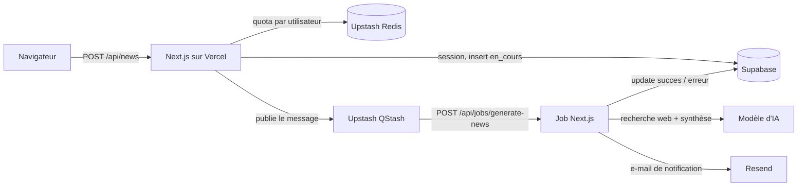

# News Sport Auto-Moto

## Présentation

News Sport Auto-Moto est une application web qui résume, grâce à un modèle d'IA générative, l'actualité de la semaine dans cinq disciplines du sport mécanique : Formule 1, MotoGP, rallye (WRC), endurance (WEC) et NASCAR.

Elle s'adresse aux passionnés qui veulent suivre plusieurs championnats sans lire des dizaines d'articles. L'utilisateur se connecte, choisit une discipline et reçoit une synthèse des résultats, du classement et des faits marquants des 7 derniers jours. Toutes ses demandes sont conservées : il peut retrouver chaque news dans son historique et il est prévenu par e-mail dès qu'une synthèse est prête.

Fonctionnalités principales :

- connexion et création de compte ;
- formulaire de demande (choix d'une discipline) ;
- génération asynchrone de la synthèse, avec nouvelles tentatives automatiques en cas d'erreur passagère ;
- historique des news de l'utilisateur, avec leur statut (en cours, réussie, en échec) ;
- page de détail pour chaque news ;
- notification par e-mail à la fin de la génération ;
- quota de demandes par utilisateur et par heure.

## Adresse de production

[À compléter : https://ton-projet.vercel.app]

Dépôt GitHub : https://github.com/ViaudYann/TDCloudComputing-NewsSportAuto

## Architecture



| Service | Rôle |
|---|---|
| **Next.js** (App Router, TypeScript) | Interface (formulaire, historique, détail) et routes API côté serveur. Les clés secrètes ne quittent jamais le serveur. |
| **Vercel** | Hébergement et déploiement continu : chaque push sur `main` déclenche un nouveau déploiement. |
| **Supabase Auth** | Comptes utilisateurs et sessions. Chaque news est rattachée à son auteur. |
| **Supabase Postgres** | Stockage des news, avec Row Level Security pour isoler les données de chaque utilisateur. |
| **Upstash QStash** | File de messages : la génération est lancée en arrière-plan, avec nouvelles tentatives automatiques. |
| **Upstash Redis** | Limitation du nombre de demandes par utilisateur et par heure. |
| **Resend** | Envoi de l'e-mail qui prévient l'utilisateur que sa news est prête ou a échoué. |
| **Service d'IA** | Recherche de l'actualité de la semaine et rédaction de la synthèse. |

### Briques au choix et pourquoi

**Génération asynchrone avec QStash.** Une synthèse qui s'appuie sur une recherche web peut prendre plusieurs dizaines de secondes. Faire attendre le navigateur exposerait à la limite de durée des fonctions Vercel et bloquerait l'utilisateur. La route `/api/news` enregistre donc la demande avec le statut `en_cours`, publie un message dans QStash et répond immédiatement (code 202). QStash appelle ensuite la route `/api/jobs/generate-news`, qui génère la news et met la ligne à jour. Les avantages :

- l'utilisateur n'attend pas : il peut quitter la page et revenir plus tard ;
- les erreurs passagères (quota du fournisseur, délai dépassé, erreur 5xx) sont réessayées automatiquement, jusqu'à 3 fois ;
- les appels au job sont signés par QStash et vérifiés avec `verifySignatureAppRouter`, donc personne d'autre ne peut déclencher une génération ;
- le job est idempotent : une news qui n'est plus `en_cours` n'est jamais générée deux fois, même si un message est livré en double.

**Limitation de débit avec Upstash Redis.** Chaque génération consomme des crédits chez le fournisseur d'IA, et la recherche web coûte plus cher qu'un simple résumé. Un quota par utilisateur protège le budget et le service. Si Redis est indisponible, la requête est acceptée quand même (choix « fail open »), pour ne pas bloquer tous les utilisateurs à cause d'une panne secondaire.

**Notifications par e-mail avec Resend.** La génération étant asynchrone, l'utilisateur doit savoir quand revenir. Le job envoie un e-mail en cas de réussite ou d'échec définitif. Un échec d'envoi est journalisé mais ne fait jamais échouer le traitement de la news.

## Modèle d'IA

- **Fournisseur :** [À compléter]
- **Modèle :** [À compléter : valeur de `AI_MODEL`]

L'application appelle le modèle via une API compatible OpenAI (`/chat/completions`). Le fournisseur peut donc être changé avec les seules variables `AI_BASE_URL`, `AI_API_KEY` et `AI_MODEL`, sans modifier le code.

Justification : [À compléter, avec les critères suivants]

- **Recherche web intégrée (critère indispensable).** Les news de la semaine sont, par définition, postérieures aux données d'entraînement de n'importe quel modèle. Sans accès au web, le modèle inventerait des résultats plausibles mais faux.
- **Sortie structurée.** La réponse est demandée au format JSON (`response_format` de type `json_schema`) puis validée par le code, avec une nouvelle tentative si le format n'est pas respecté.
- **Coût et quota** adaptés à un projet étudiant.
- **Qualité du français** de la synthèse.

Le prompt système impose une synthèse factuelle de 100 à 200 mots, interdit d'inventer des résultats et demande au modèle d'ignorer toute instruction contenue dans les pages web consultées (protection contre l'injection de prompt).

## Structure de données

### Table `news_sport_meca`

| Colonne | Type | Contraintes | Rôle |
|---|---|---|---|
| `id` | `uuid` | clé primaire, `gen_random_uuid()` | Identifiant de la news |
| `sport_meca` | `text` | non nul | Discipline (`f1`, `motogp`, `rallye`, `endurance`, `nascar`) |
| `synthese` | `text` | facultatif | Synthèse générée par l'IA, vide tant que la news n'est pas prête ou si elle a échoué |
| `date_creation` | `timestamptz` | non nul, `now()` | Date de la demande |
| `user_id` | `uuid` | non nul, `auth.uid()`, clé étrangère vers `auth.users(id)`, `on delete cascade` | Auteur de la demande |
| `statut` | `text` | non nul, `'en_cours'` par défaut, `check` sur `en_cours`, `succes`, `erreur` | Avancement de la génération |
| `message_erreur` | `text` | facultatif | Message lisible en cas d'échec |

Un index sur `user_id` accélère l'affichage de l'historique de chaque utilisateur.

### Relations

Chaque news appartient à un utilisateur de `auth.users` (relation un-à-plusieurs). La suppression d'un compte supprime ses news (`on delete cascade`). La colonne `user_id` est remplie automatiquement avec `auth.uid()` : le code n'a jamais à l'envoyer, et ne peut donc pas usurper un autre auteur.

### Règles de sécurité (Row Level Security)

Le RLS est activé sur la table. Seules deux opérations sont autorisées aux utilisateurs connectés :

- **lecture** : chacun ne lit que ses propres news (`(select auth.uid()) = user_id`) ;
- **insertion** : chacun ne crée que des news à son nom (même condition en `with check`).

Aucune policy ne permet de modifier ou supprimer une news depuis l'application. La mise à jour de la synthèse et du statut est faite par le job, qui n'a pas de session utilisateur : il utilise le client administrateur (clé `service_role`), uniquement côté serveur.

L'isolation a été testée en insérant une news au nom d'un autre compte depuis l'éditeur SQL : elle n'apparaît ni dans l'historique ni via son adresse directe (page 404).

### Script de création

```sql
create table public.news_sport_meca (
  id              uuid primary key default gen_random_uuid(),
  sport_meca      text not null,
  synthese        text,
  date_creation   timestamptz not null default now(),
  user_id         uuid not null default auth.uid()
                  references auth.users (id) on delete cascade,
  statut          text not null default 'en_cours'
                  check (statut in ('en_cours', 'succes', 'erreur')),
  message_erreur  text
);

create index news_sport_meca_user_id_idx on public.news_sport_meca (user_id);

alter table public.news_sport_meca enable row level security;

create policy "Chacun lit ses propres news"
  on public.news_sport_meca
  for select
  to authenticated
  using ((select auth.uid()) = user_id);

create policy "Chacun crée ses propres news"
  on public.news_sport_meca
  for insert
  to authenticated
  with check ((select auth.uid()) = user_id);
```

## Lancer le projet en local

### Prérequis

- Node.js 18 ou plus récent
- Un projet Supabase
- Un compte Upstash (Redis et QStash)
- Un compte Resend
- Une clé API d'un fournisseur d'IA compatible OpenAI, avec un modèle doté de la recherche web

### Installation

```bash
git clone https://github.com/ViaudYann/TDCloudComputing-NewsSportAuto.git
cd TDCloudComputing-NewsSportAuto
npm install
```

Dans le SQL Editor de Supabase, exécuter le script de la section « Script de création ».

### Variables d'environnement

Copier `.env.example` en `.env.local` puis renseigner :

| Variable | Rôle |
|---|---|
| `NEXT_PUBLIC_SUPABASE_URL` | Adresse du projet Supabase |
| `NEXT_PUBLIC_SUPABASE_ANON_KEY` | Clé publique Supabase (soumise au RLS) |
| `SUPABASE_SERVICE_ROLE_KEY` | Clé administrateur, utilisée uniquement par le job côté serveur |
| `AI_BASE_URL` | Adresse de l'API compatible OpenAI |
| `AI_API_KEY` | Clé du fournisseur d'IA |
| `AI_MODEL` | Nom du modèle |
| `UPSTASH_REDIS_REST_URL` | Adresse de la base Redis |
| `UPSTASH_REDIS_REST_TOKEN` | Jeton de la base Redis |
| `QSTASH_URL` | Adresse de QStash (serveur local en développement) |
| `QSTASH_TOKEN` | Jeton QStash |
| `QSTASH_CURRENT_SIGNING_KEY` | Clé de vérification des signatures QStash |
| `QSTASH_NEXT_SIGNING_KEY` | Clé de vérification suivante (rotation) |
| `RESEND_API_KEY` | Clé de l'API Resend |
| `APP_URL` | Adresse de l'application (`http://localhost:3000` en local) |

Le fichier `.env.local` est exclu de Git. Les mêmes variables doivent être renseignées dans Vercel (Settings > Environment Variables), avec les valeurs de production.

### Commandes

Dans un premier terminal, lancer le serveur QStash de développement. Il affiche un `QSTASH_TOKEN` et des clés de signature à copier dans `.env.local`, avec `QSTASH_URL=http://127.0.0.1:8080` :

```bash
npx @upstash/qstash-cli dev
```

Dans un second terminal, lancer l'application :

```bash
npm run dev
```

L'application est disponible sur http://localhost:3000.

Remarques :

- Sur un poste dont la politique de sécurité bloque les exécutables non approuvés (Windows Device Guard par exemple), le serveur QStash local ne peut pas démarrer. La génération asynchrone peut alors être testée sur le déploiement de production, ou depuis GitHub Codespaces.
- Avec l'expéditeur de test `onboarding@resend.dev`, Resend n'envoie qu'à l'adresse du compte Resend : utiliser cette adresse pour tester les notifications.
